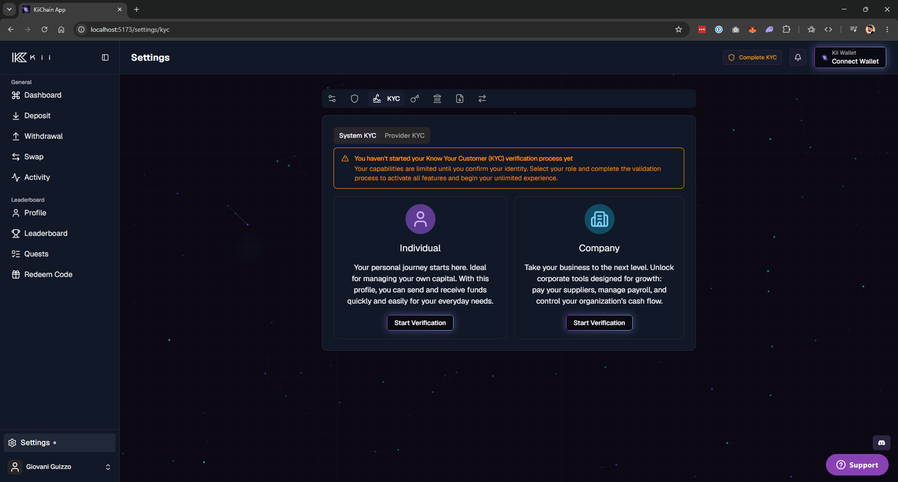
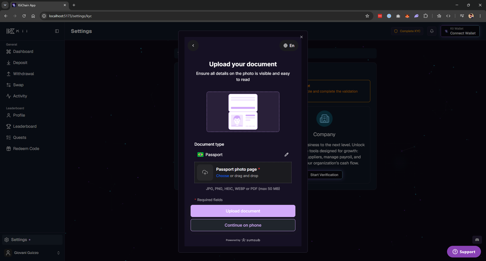
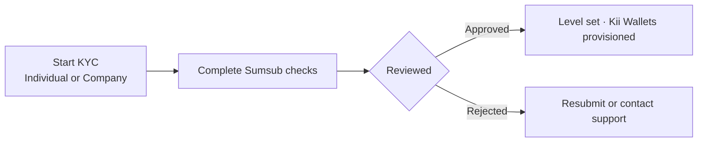
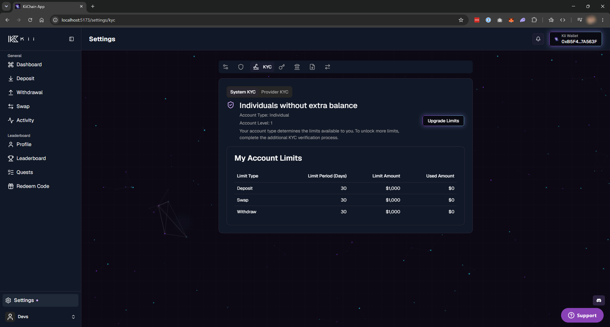
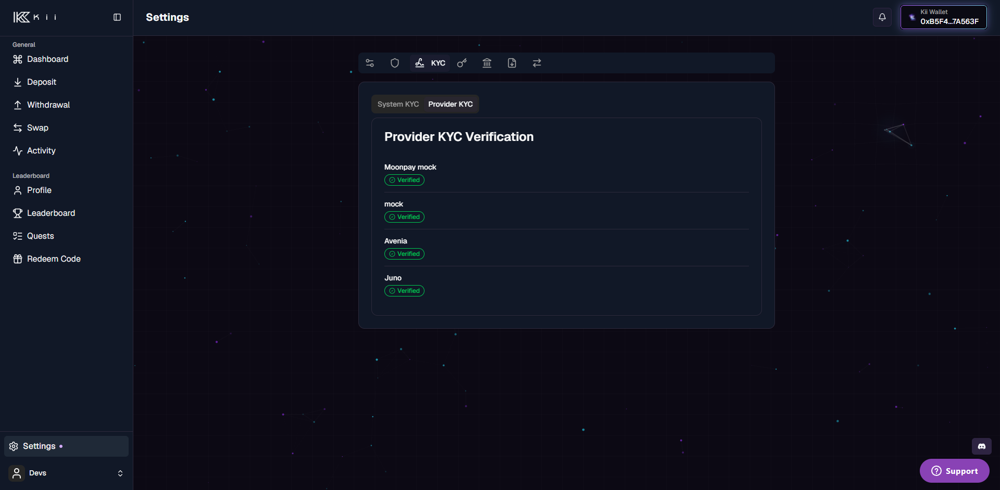

# KYC

KYC (Know Your Customer) is the gate that unlocks KiiChain Pay for an account. Until an account is verified it has **no Kii Wallets, no limits, and no access** to fiat rails. Completing KYC provisions the account's [Kii Wallets](internal-wallets.md) and sets its transaction limits.


KYC gates **Kii Wallets, fiat on-/off-ramps and limits** — not the chain itself. A user can still run **DEX swaps** anonymously from their own external wallet with no account and no KYC. See [Internal wallets](internal-wallets.md#how-funds-move).


There are **two independent verification flows**:

1. **System KYC** — KiiChain Pay's own identity verification. Sets your **account level** and platform-wide limits. **Every account completes this.**
2. **Provider KYC / KYB** — occasional extra verification a specific provider may require, and only in certain cases and countries. **Most integrators never need it.** Covered [below](#provider-kyc-kyb).

## System KYC

### Account levels and limits

An account has a **level** (0, 1, or 2) and a **type** (individual or company). Level 0 means no KYC — no access. Levels 1 and 2 unlock rising limits, applied **per action** (`deposit`, `withdraw`, `swap`) in **USD** over a **rolling 30-day** window.

<table><thead><tr><th width="150">Account type</th><th width="100">Level</th><th>Limit per action (USD / 30 days)</th></tr></thead><tbody>
<tr><td>Individual</td><td>1</td><td>1,000</td></tr>
<tr><td>Individual</td><td>2</td><td>5,000</td></tr>
<tr><td>Company</td><td>1</td><td>10,000</td></tr>
<tr><td>Company</td><td>2</td><td>20,000</td></tr>
</tbody></table>


Level 1 is granted on first successful verification. Level 2 is a limit upgrade you request after reaching level 1. Individual accounts that pass a company verification become company accounts.


### The verification flow

System KYC uses the **Sumsub** identity platform, embedded directly in the KiiChain Pay app.

In the app, go to **Settings → KYC** and choose **Individual** or **Company** verification.

<figure><figcaption><p>Settings → KYC: the <strong>Individual</strong> and <strong>Company</strong> verification options, before starting.</p></figcaption></figure>

Starting verification opens the Sumsub flow, where the user completes identity checks (and, for companies, company documents).

<figure><figcaption><p>The embedded Sumsub flow — here, the document-upload step.</p></figcaption></figure>



When the review is approved, the account's level and type are set and its **Kii Wallets are provisioned automatically**. The verified level and current limits are then shown in the dashboard.

<figure><figcaption><p>Verified: account type, level, the per-action limits table, and the <strong>Upgrade Limits</strong> action (level 1 → 2).</p></figcaption></figure>

### Individual vs. company

- **Individual** verification requires personal identity documents.
- **Company** verification (KYB) additionally requires a **company name** and company documentation, and typically covers the authorized representative and the business itself. Company accounts receive higher limits (see the table above).

### KYC status

The dashboard surfaces a status for the verification — for example _not started_, _pending_, _completed_, _verified_, or _rejected_ — with a contextual banner guiding the next step. A rejection may be final or ask the user to resubmit with better documents.

## Provider KYC / KYB


**Most integrators can skip this.** System KYC (above) is all you need in the common case. Provider KYC is required only in very specific cases and specific countries, where a third-party on-/off-ramp provider imposes its own compliance requirements. **You don't need to seek it out in advance** — when a transaction needs it, KiiChain Pay prompts you to complete that provider's verification.


Some on- and off-ramp providers are third parties with their **own** compliance requirements. In those cases, an account must complete that provider's KYC (or KYB, for companies) before transacting through it — this is **separate** from system KYC above, and it's requested only when needed.

When it applies, the **KYC** page's **Providers** tab lists the relevant provider with its verification status (e.g. _pending_, _processing_, _verified_, _rejected_).

<figure><figcaption><p>The <strong>Provider KYC</strong> tab, listing each relevant provider with its verification status.</p></figcaption></figure>

When prompted, starting provider verification opens the provider's flow (a redirect rather than an embedded SDK). **Company (KYB)** accounts complete an extra step — an authorized-representative flow plus a basic company-data step — whereas individuals complete a single flow.


Provider verification is per provider: verifying with one provider does not verify you with another. When a provider is required, check its status before routing a transaction through it.


## What your account can use

KYC decides which assets and rails an account can use, not just whether it can use KiiChain Pay at all. Rails, swap pairs and fiat holdings each carry an **`availability`** object that tells you, for the requesting account, whether it can be used and, if not, why.

```json
{
  "allowed": false,
  "reason": "fiat_country_required",
  "requiredCountries": ["BRA"]
}
```

<table><thead><tr><th width="200">Field</th><th>Meaning</th></tr></thead><tbody>
<tr><td><code>allowed</code></td><td>Whether the account can use the row. Always present.</td></tr>
<tr><td><code>reason</code></td><td>Why the row is blocked. Unset when <code>allowed</code> is <code>true</code>.</td></tr>
<tr><td><code>requiredCountries</code></td><td>ISO 3166-1 alpha-3 codes that would unlock the row. Only set for <code>fiat_country_required</code>.</td></tr>
<tr><td><code>providerId</code>, <code>providerName</code></td><td>The provider whose onboarding is pending. Only set for <code>provider_kyc_required</code>.</td></tr>
</tbody></table>

### Blocking reasons

<table><thead><tr><th width="230">Reason</th><th>Meaning</th><th>What to do</th></tr></thead><tbody>
<tr><td><code>kyc_required</code></td><td>The account hasn't completed system KYC (level 0).</td><td>Complete <a href="#system-kyc">system KYC</a>.</td></tr>
<tr><td><code>country_not_supported</code></td><td>The provider doesn't serve the account's country.</td><td>Use another rail for the same asset, if one is allowed.</td></tr>
<tr><td><code>fiat_country_required</code></td><td>The fiat can only be used by accounts from its issuing country, and none of the account's countries match.</td><td>The account needs one of the <code>requiredCountries</code>. Contact support if its countries are wrong.</td></tr>
<tr><td><code>provider_kyc_required</code></td><td>The provider runs its own onboarding and hasn't approved the account yet.</td><td>Complete <a href="#provider-kyc-kyb">provider KYC</a> with <code>providerName</code>.</td></tr>
<tr><td><code>not_offered</code></td><td>No provider currently offers deposits into this fiat.</td><td>Nothing on your side. The balance can still be held.</td></tr>
</tbody></table>

Each fiat is tied to its issuing countries: **BRL** to Brazil, **COP** to Colombia, **MXN** to Mexico, **USD** to the United States, and **EUR** to the euro area members. `GET /accounts/v1/accounts/{accountId}/countries` lists the countries on an account.

### Where it appears

<table><thead><tr><th width="300">Endpoint</th><th>Field</th><th>Possible reasons</th></tr></thead><tbody>
<tr><td><code>GET /market/v1/products-providers</code></td><td><code>productsProviders[].availability</code></td><td><code>kyc_required</code>, <code>country_not_supported</code>, <code>fiat_country_required</code></td></tr>
<tr><td><code>GET /market/v1/instruments</code></td><td><code>instruments[].availability</code></td><td><code>kyc_required</code>, <code>country_not_supported</code></td></tr>
<tr><td><code>GET /market/v1/trade-instruments</code></td><td><code>tradeInstruments[].products[].availability</code></td><td><code>kyc_required</code>, <code>country_not_supported</code></td></tr>
<tr><td><code>GET /portfolio/v1/portfolio</code></td><td>each fiat holding's <code>availability</code></td><td>all five</td></tr>
</tbody></table>

### In your portfolio

The portfolio's fiat holdings list every fiat the account **holds or can deposit into**, each with its `availability`:

- A fiat is allowed when **any** provider lets the account deposit into it. When none does, the first blocking reason is reported, and it stays the same between calls.
- A fiat the account can deposit into but doesn't hold yet appears with a **zero balance**, so you can show it before the first deposit.
- A fiat the account holds but no provider offers anymore still appears, marked `not_offered`.

## Next steps

- [Internal wallets](internal-wallets.md) — provisioned automatically once system KYC is approved.
- [Creating an on-ramp](../guides/quick-start/creating-an-on-ramp.md) — where provider KYC may come into play.
