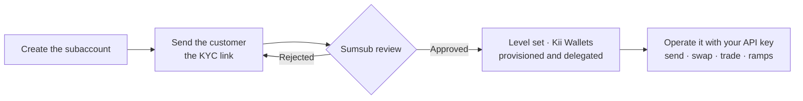

# Subaccounts

A **subaccount** is an account a company creates for one of its own customers. The customer never signs up to KiiChain Pay or logs in: the company creates the subaccount, sends the customer a KYC link, and from then on operates the subaccount through its own [API key](generating-api-keys.md), just like its own account.

Each subaccount is a full KiiChain Pay account. It has its own [KYC](kyc.md) level and limits, its own [Kii Wallets](internal-wallets.md), its own withdrawal destinations and its own activities, all separate from the company's.


Only a **KYC-verified company account** can have subaccounts, and a subaccount can't have subaccounts of its own.




## Access

A subaccount is operated with the company's API key, by passing the **subaccount's ID** wherever an endpoint takes an account ID (`{accountId}` in the path or `account_id` in the body or query). KiiChain Pay checks that the subaccount belongs to the company calling it.

On top of the scope each endpoint already requires, acting on a subaccount needs one of these scopes on the key:

<table><thead><tr><th width="280">Scope</th><th>Needed for</th></tr></thead><tbody><tr><td><code>accounts.subaccounts.read</code></td><td>Read endpoints called on a subaccount, and listing or getting subaccounts.</td></tr><tr><td><code>accounts.subaccounts.write</code></td><td>Every other endpoint called on a subaccount, and creating subaccounts or KYC links.</td></tr></tbody></table>

For example, sending from a subaccount's Kii Wallet needs `blockchain.wallets.send` **and** `accounts.subaccounts.write`.

Some endpoints only make sense on the company account itself and are refused when called with a subaccount's ID: account deletion, billing and subscriptions, system KYC (`StartKyc`, subaccounts use the [KYC link](subaccounts.md#2.-send-the-customer-a-kyc-link) instead), and managing subaccounts.

## Onboarding a customer

The examples assume `KII_API_KEY` holds the company's API key and `KII_ACCOUNT_ID` the company's account ID. Write requests also carry the `x-timestamp` and `x-signature` headers described in [Sign write requests](generating-api-keys.md#4.-sign-write-requests).

### 1. Create the subaccount

`POST /accounts/v1/accounts/{accountId}/subaccounts`, where `{accountId}` is the company's account. Requires `accounts.subaccounts.write`.

<table><thead><tr><th width="150">Field</th><th>Description</th></tr></thead><tbody><tr><td><code>name</code></td><td>The subaccount's name, usually the customer's name (1–64 characters). Required.</td></tr><tr><td><code>country</code></td><td>The customer's country, ISO 3166-1 alpha-3 (e.g. <code>BRA</code>). Required.</td></tr><tr><td><code>external_ref</code></td><td>Your own identifier for the customer, unique within your company (1–128 characters). Optional.</td></tr></tbody></table>

```bash
curl -X POST "https://backend.pay.kiichain.io/accounts/v1/accounts/$KII_ACCOUNT_ID/subaccounts" \
  -H "Authorization: APIKey $KII_API_KEY" \
  -H "x-timestamp: $KII_TIMESTAMP" \
  -H "x-signature: $KII_SIGNATURE" \
  -H "Idempotency-Key: $(uuidgen)" \
  -H "Content-Type: application/json" \
  -d '{
    "name": "Maria Silva",
    "country": "BRA",
    "external_ref": "customer-1234"
  }'
```

The response holds the new subaccount. Its `account.id` is the subaccount ID you use from now on:

```json
{
  "subaccount": {
    "account": {
      "id": "115f5269-1dd7-4be8-8af4-2fd38ce8478f",
      "accountName": "Maria Silva",
      "accountType": "individual",
      "countries": ["BRA"]
    },
    "parentAccountId": "4a01b6fe-0fd6-4d29-b5b0-a2ad6ac4c5f2",
    "externalRef": "customer-1234"
  }
}
```


Retrying with the same `external_ref` returns the subaccount that was already created instead of a second one, so it's safe to retry a create that timed out.


To find subaccounts later, `GET /accounts/v1/accounts/{accountId}/subaccounts` lists them (with `page`, `limit`, and an exact-match `external_ref` filter) and `GET /accounts/v1/accounts/{accountId}/subaccounts/{subaccountId}` gets one. Both require `accounts.subaccounts.read`.

### 2. Send the customer a KYC link

`POST /accounts/v1/accounts/{accountId}/subaccounts/{subaccountId}/kyc/link` returns a link to the hosted Sumsub verification page for that subaccount. Send it to your customer, by email, chat or inside your app. Requires `accounts.subaccounts.write`.

<table><thead><tr><th width="150">Field</th><th>Description</th></tr></thead><tbody><tr><td><code>lang</code></td><td>Two-letter language of the verification page (e.g. <code>en</code>, <code>es</code>, <code>pt</code>). Optional.</td></tr></tbody></table>

```bash
curl -X POST "https://backend.pay.kiichain.io/accounts/v1/accounts/$KII_ACCOUNT_ID/subaccounts/$KII_SUBACCOUNT_ID/kyc/link" \
  -H "Authorization: APIKey $KII_API_KEY" \
  -H "x-timestamp: $KII_TIMESTAMP" \
  -H "x-signature: $KII_SIGNATURE" \
  -H "Content-Type: application/json" \
  -d '{ "lang": "pt" }'
```

```json
{
  "kycUrl": "https://in.sumsub.com/websdk/p/…",
  "expiresAt": "2026-11-12T10:49:26Z"
}
```

* The link is valid for **7 days**.
* If the customer loses it or it expires, call the endpoint again. You get a new link to the **same** verification, and anything the customer already submitted is kept.
* Once the subaccount is verified, the endpoint answers `KYC applicant already verified`.

### 3. Wait for the review

When Sumsub approves the customer, the subaccount gets its KYC level and limits, and its [Kii Wallets](internal-wallets.md) are provisioned. Check it with the get subaccount endpoint: `account.kycInfo.status` becomes `verified` and `account.kycInfo.level` is set.

```bash
curl "https://backend.pay.kiichain.io/accounts/v1/accounts/$KII_ACCOUNT_ID/subaccounts/$KII_SUBACCOUNT_ID" \
  -H "Authorization: APIKey $KII_API_KEY"
```

A subaccount's Kii Wallets are **already delegated** to the platform signer, so unlike your own account there's no [delegation](privy-delegated-access.md) step: you can send and execute from them as soon as they exist.

## Operating a subaccount

From here on, use the subaccount's ID as the account ID in the regular endpoints and guides.

### Wallets and transfers

The [Kii Wallet endpoints](internal-wallets.md#accessing-wallets-via-the-api) work the same with the subaccount's ID: list its wallets, send from them, and execute prepared transactions, without MFA (see [MFA](subaccounts.md#mfa)).

```bash
curl "https://backend.pay.kiichain.io/blockchain/v1/accounts/$KII_SUBACCOUNT_ID/wallets/internal" \
  -H "Authorization: APIKey $KII_API_KEY"
```

### Withdrawal destinations

Register destinations on the subaccount with `POST /accounts/v1/accounts/{subaccountId}/withdrawal_destinations`, as described in [Discovering rails & IDs](../guides/#discovering-rails-and-ids). On a subaccount the destination is **confirmed right away**: there's no verification code to send back, because the code would go to the company's email rather than the customer's.

### Ramps, swaps and trades

The [guides](../guides/) apply as they are: pass the subaccount's ID as `account_id`, and its Kii Wallet address as `user_chain_address`. When a guide signs with a delegated Kii Wallet, call `transactions/execute` with the subaccount's ID.

**Permit swaps.** Some swap providers take the input tokens with a signed permit instead of an on-chain transaction. Their swap activity returns a `typedData` action rather than `evm` transactions. Sign it with the subaccount's Kii Wallet, then submit the signature on the activity:

```bash
# Sign the typed data with the subaccount's Kii Wallet
curl -X POST "https://backend.pay.kiichain.io/blockchain/v1/accounts/$KII_SUBACCOUNT_ID/wallets/internal/sign-typed-data" \
  -H "Authorization: APIKey $KII_API_KEY" \
  -H "x-timestamp: $KII_TIMESTAMP_1" \
  -H "x-signature: $KII_SIGNATURE_1" \
  -H "Content-Type: application/json" \
  -d '{ "typed_data": "… the typedData.typedData string from the activity …" }'

# Submit it on the activity
curl -X POST "https://backend.pay.kiichain.io/tickets/v1/$KII_TICKET_ID/signature" \
  -H "Authorization: APIKey $KII_API_KEY" \
  -H "x-timestamp: $KII_TIMESTAMP_2" \
  -H "x-signature: $KII_SIGNATURE_2" \
  -H "Content-Type: application/json" \
  -d '{
    "account_id": "'"$KII_SUBACCOUNT_ID"'",
    "type": "permit",
    "signature": "0x…"
  }'
```

`sign-typed-data` requires `blockchain.transactions.execute` and returns `{ "signature": "0x…" }`, the 65-byte EIP-712 signature.

Each request is signed on its own: the signature covers the timestamp, method, path and body, so compute a fresh `x-timestamp` and `x-signature` for the second call rather than reusing the first one's.

### Provider KYC

When a provider needs its own [KYC](kyc.md#provider-kyc-kyb) for the subaccount, start it with the subaccount's ID and send the returned `nextUrl` to your customer:

```bash
curl -X POST "https://backend.pay.kiichain.io/market/v1/providers/$KII_PROVIDER_ID/kyc/$KII_SUBACCOUNT_ID/start" \
  -H "Authorization: APIKey $KII_API_KEY" \
  -H "x-timestamp: $KII_TIMESTAMP" \
  -H "x-signature: $KII_SIGNATURE" \
  -H "Content-Type: application/json" \
  -d '{}'
```

The provider account is opened under the subaccount's `name`, the customer, not under your company. Calling `start` again while the verification is in progress returns the same link, and `POST /market/v1/providers/{providerId}/kyc/{accountId}` returns the current status.

## MFA

You don't need to do anything for this. Because the company's integration has no authenticator code to send, these endpoints skip the `X-Mfa-Code` check when they're called **on a subaccount with an API key**:

* `POST /blockchain/v1/accounts/{accountId}/wallets/internal/send`
* `POST /blockchain/v1/accounts/{accountId}/transactions/execute`
* `POST /blockchain/v1/accounts/{accountId}/wallets/internal/sign-typed-data`
* `POST /accounts/v1/accounts/{accountId}/withdrawal_destinations`

The same calls from a dashboard login, or on the company's own account, still require MFA.

## Next steps

* [KYC](kyc.md) — levels, limits, and what an account can use.
* [Internal wallets](internal-wallets.md) — the wallet endpoints you call with the subaccount's ID.
* [Guides](../guides/) — on-ramps, off-ramps, swaps and trades.
